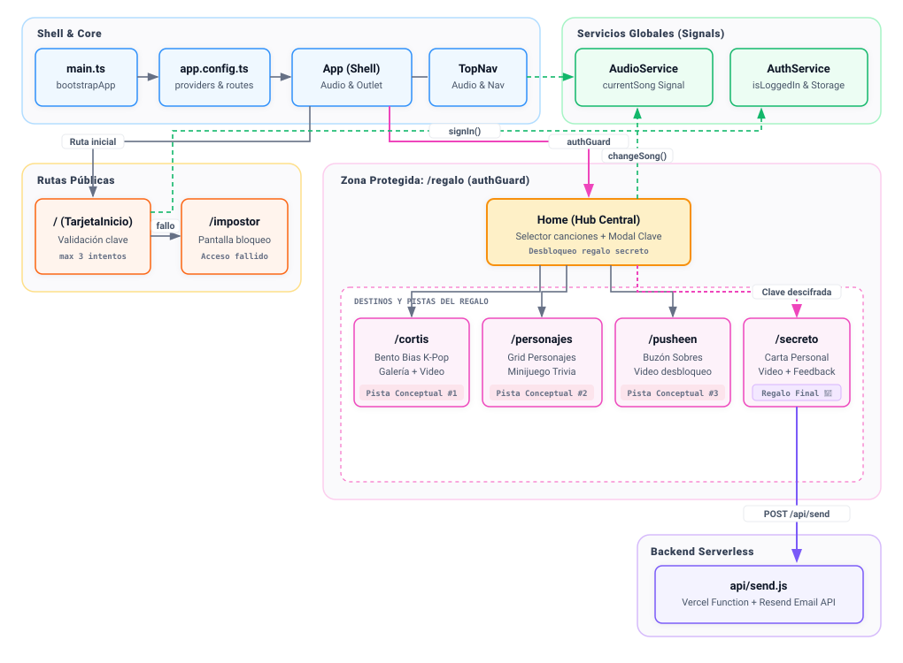

# 🎂 Sorpresa para Tiara 🎁

🌐 **[🚀 Visitar la página web en vivo](https://tiara-cumple-2027.vercel.app/)** 🌐

Este repositorio contiene el código fuente de un regalo digital interactivo creado especialmente para el cumpleaños de mi amiga, Tiara. 

El proyecto es una **Single Page Application (SPA)** concebida como una experiencia inmersiva, visual y personalizada. Combina sus temáticas y gustos favoritos en un formato de "tarjeta web moderna" enriquecida con mecánicas de exploración y *Escape Room*.

> 💡 **Nota sobre el estado del proyecto:** La arquitectura técnica y los sistemas interactivos se encuentran estabilizados. La capa de contenido creativo (textos finales, pistas, cartas y piezas audiovisuales) se encuentra en desarrollo activo y sujeta a iteraciones narrativas previas al lanzamiento.

---

## 🎨 Diseño y Temática

La interfaz está inspirada en una estética **Y2K / Kawaii**, buscando un equilibrio entre diseño editorial moderno y calidez visual:

* **UI / UX Glassmorphism:** Componentes con fondos traslúcidos con efecto de vidrio esmerilado, paleta de colores pastel unificada, tipografías variables (`Fredoka Variable` para encabezados lúdicos y `Quicksand Variable` para lectura) y modales nativos accesibles.
* **Identidad Pusheen:** Animaciones y recursos visuales integrados como lenguaje visual de feedback (reacciones al ingreso de contraseñas, estados de sobres, transiciones de carga y alertas de juego).
* **Ambientación Musical Adaptativa:** Reproductor de música continuo con una selección personalizada de pistas K-Pop, conmutable dinámicamente y con sincronización entre componentes.

---

## 🏗 Arquitectura del Sistema

La aplicación está construida sobre **Angular 22** bajo un modelo estricto de componentes autónomos (*Standalone Components*), complementada con una función *serverless* para eventos transaccionales.



### Shell Principal y Continuidad de Audio
El componente raíz `App` actúa como shell estructural: aloja de forma permanente el reproductor de audio global y el punto de montaje de rutas (`<router-outlet>`). La gestión y control del elemento de audio está completamente centralizada en `AudioService`, eliminando cualquier manipulación directa del DOM desde los componentes y exponiendo señales reactivas (`isPlaying`, `currentSong`). Al mantener el reproductor en la raíz, la música continúa sonando sin interrupciones durante las transiciones entre páginas. La barra superior `TopNav` actúa como interfaz de control global, sincronizándose con el estado reactivo del servicio y adaptando las acciones de retorno (`Volver` vs `Salir`) según la ruta activa.

### Enrutamiento, Carga Diferida y Seguridad (`authGuard` y `secretGuard`)
El enrutador organiza la aplicación en áreas funcionales y optimiza el bundle inicial mediante carga diferida (*Lazy Loading* con `loadComponent` y dynamic imports) en todos los destinos secundarios:
* **Área pública:** Rutas de acceso inicial (`/` con `TarjetaInicio`) y pantalla de bloqueo preventivo (`/impostor`).
* **Zona protegida (`/regalo`):** Agrupa como rutas hijas el panel central (`Home`) y las distintas subsecciones temáticas. El acceso al conjunto está custodiado por `authGuard`, un guardia funcional (`CanActivateFn`) que verifica la sesión activa en el servicio de autenticación antes de permitir la navegación.
* **Protección del Destino Secreto (`secretGuard`):** La ruta final (`/regalo/secreto`) cuenta con una capa de seguridad adicional mediante `secretGuard`, impidiendo el acceso directo por URL o manipulación del historial hasta que la combinación de pistas haya sido validada satisfactoriamente en el hub central.

### Gestión de Estado y Servicios Reactivos
La reactividad se gestiona mediante señales (`signal`) y cálculos derivados (`computed`):
* **`AudioService`:** Centraliza la reproducción global de la banda sonora, el control del elemento de audio, la señal reactiva `isPlaying` y el cambio dinámico de pistas.
* **`SoundEffectsService`:** Servicio singleton (`providedIn: 'root'`) que precarga y gestiona en memoria el ciclo de vida de los efectos sonoros de la interfaz (SFX de éxito, error y alertas de login), previniendo rechazos de promesas de audio (`.catch()`) y optimizando la latencia sonora.
* **`AuthService`:** Controla el estado de autenticación y su persistencia en el almacenamiento local (`localStorage`).
* **Señales Computadas (`computed`):** Utilizadas en componentes de alto dinamismo para derivar estados complejos (como el degradado cónico de la ruleta y las preguntas disponibles en el minijuego) de manera reactiva y memoizada, evitando evaluaciones redundantes en los ciclos de detección de cambios.

### Flujo hacia el Backend Serverless
La interacción con servicios externos se realiza de manera asíncrona desde la sección final. El formulario de dedicatoria despacha una petición `POST` mediante `HttpClient` (configurado globalmente vía `provideHttpClient()`) y `firstValueFrom` hacia `/api/send`, ejecutada por una función *serverless* en Node.js que procesa la respuesta y utiliza la API de **Resend** para notificarla directamente por correo electrónico, manteniendo las claves de servidor totalmente aisladas del cliente.

---

## 🚶 Flujo de Navegación y Mecánica de Desbloqueo

La experiencia está diseñada como una progresión no lineal que premia la curiosidad y la exploración:

```
[ Acceso / Login ] ──(Clave válida)──> [ Hub Central (Home) ]
        │                                      │
        └──(Límite de fallos)──> [ Impostor ]  ├──> [ Destino Editorial ] ──> Pista Conceptual #1
                                               ├──> [ Destino Desafío ]   ──> Pista Conceptual #2
                                               ├──> [ Destino Mensajes ]  ──> Pista Conceptual #3
                                               │
                                               └──(Combinación final)─────> [ Destino Secreto ] ──> [ Feedback ]
```

1. **Acceso Inicial (`TarjetaInicio`):** Verificación de identidad. Si se superan los intentos máximos permitidos, el sistema activa una redirección preventiva a una pantalla de bloqueo (`Impostor`). Con la clave correcta, se inicia la sesión y comienza la ambientación musical.
2. **Hub Central (`Home`):** Panel interactivo donde la usuaria puede cambiar la banda sonora en tiempo real y explorar los destinos abiertos mediante botones semánticos nativos. El destino final ("Regalo Sorpresa") permanece protegido con un candado virtual.
3. **Exploración y Recolección de Pistas:**
   - **Destino Editorial:** Espacio temático con formato de revista visual donde, al interactuar con las galerías, se revela la primera pista conceptual.
   - **Destino Desafío:** Galería visual que esconde un disparador hacia un minijuego de preguntas. Superar la prueba de conocimiento otorga la segunda pista conceptual.
   - **Destino Mensajes:** Buzón con sobres interactivos evaluados de forma reactiva en $O(1)$. Abrir todos los mensajes desbloquea la tercera pista conceptual.
4. **Desbloqueo del Destino Secreto:** La usuaria introduce la combinación de las pistas en el modal interactivo de `Home`. El sistema normaliza el texto (eliminando espacios y tolerando variaciones habituales al escribir) y, si coincide con la clave de desbloqueo, habilita el acceso a la sección final custodiada por `secretGuard`.
5. **Experiencia Final y Feedback:** En la zona secreta se accede a la carta principal, material audiovisual especial y un formulario interactivo para enviar su reacción por correo electrónico.

---

## 📁 Estructura del Proyecto

Organización modular del código fuente:

```
tiara-cumple2027/
├── api/
│   └── send.js                           # Endpoint serverless (Vercel + Resend API)
├── docs/
│   ├── architecture.mmd                  # Definición del diagrama en sintaxis Mermaid
│   └── architecture.svg                  # Diagrama de arquitectura optimizado
├── public/
│   └── assets/                           # Activos multimedia estáticos
│       ├── audio/                        # Pistas musicales y efectos sonoros de UI
│       ├── images/                       # Fotografías, portadas, íconos y animaciones
│       └── video/                        # Archivos de video locales
├── src/
│   ├── app/
│   │   ├── components/                   # Componentes de interfaz (Standalone)
│   │   │   ├── cortis/                   # Vista editorial, bento grid y visor modal accesible
│   │   │   │   └── models/               # Modelos tipados (bias-profile.model.ts, profile-stat.model.ts)
│   │   │   ├── home/                     # Hub central, selector musical y modal de clave
│   │   │   │   └── models/               # Modelos de destinos y pistas musicales (destination.ts, track.ts)
│   │   │   ├── impostor/                 # Pantalla de bloqueo por intentos agotados
│   │   │   ├── mensajes-pusheen/         # Buzón interactivo con sobres animados y evaluación O(1)
│   │   │   │   └── models/               # Modelo de mensajes (pusheen-message.ts)
│   │   │   ├── minijuego/                # Trivia interactiva, ruleta trigonométrica y vidas
│   │   │   │   ├── data/                 # Banco estático de preguntas (questions.data.ts)
│   │   │   │   ├── models/               # Tipos de pregunta y respuesta (question.ts, answer-status.ts)
│   │   │   │   └── utils/                # Funciones puras matemáticas (roulette.utils.ts)
│   │   │   ├── personajes/               # Grilla de personajes y trigger del minijuego
│   │   │   │   └── models/               # Modelo de personajes (character.ts)
│   │   │   ├── secreto/                  # Vista final: carta, video y formulario con HttpClient
│   │   │   ├── tarjeta-inicio/           # Login inicial, validación reactiva y feedback visual
│   │   │   │   └── models/               # Estados y configuración de inicio (login-state.ts, login.config.ts)
│   │   │   └── top-nav/                  # Barra superior de navegación y control reactivo de audio
│   │   ├── guards/                       # Guards funcionales CanActivateFn
│   │   │   ├── auth.ts                   # Protección de sesión activa (authGuard)
│   │   │   └── secret.ts                 # Protección de destino sorpresa (secretGuard)
│   │   ├── models/                       # Interfaces, tipos y constantes globales
│   │   │   ├── artist.ts
│   │   │   ├── secret-clues.ts
│   │   │   └── song-source.ts
│   │   ├── services/                     # Servicios singleton inyectables
│   │   │   ├── audio.service.ts          # Control global del reproductor y estado isPlaying
│   │   │   ├── auth.ts                   # Gestión de sesión y persistencia local
│   │   │   └── sound-effects.service.ts  # Caché y reproducción de efectos sonoros (SFX)
│   │   ├── app.config.ts                 # Configuración de proveedores (HttpClient, View Transitions)
│   │   ├── app.routes.ts                 # Árbol de rutas con Lazy Loading y guards
│   │   ├── app.ts                        # Componente Shell raíz
│   │   ├── app.html                      # Template raíz con el reproductor de audio global
│   │   └── app.css                       # Estilos estructurales del shell
│   ├── main.ts                           # Bootstraping de la aplicación
│   └── styles.css                        # Variables CSS, resets, tipografías y animaciones
├── angular.json                          # Configuración de compilación y presupuestos
└── tsconfig.json                         # Configuración de TypeScript (strict: true) y Path Aliasing
```

---

## ⚙️ Decisiones Arquitectónicas

* **Angular Standalone Components:** Prescinde de módulos tradicionales para simplificar la estructura del proyecto, optimizar el empaquetado (*tree-shaking*) con Vite/esbuild y garantizar que cada componente declare explícitamente sus dependencias.
* **TypeScript en Modo Estricto (`strict: true`):** Tipado riguroso configurado a nivel de compilador (`tsconfig.json`), previniendo accesos inseguros a propiedades nulas o indefinidas (`strictNullChecks`), eliminando tipos `any` implícitos y asegurando predictibilidad en todo el ciclo de desarrollo.
* **Rutas con Carga Diferida (*Lazy Loading*):** Configuración de rutas mediante `loadComponent` y dynamic imports (`import()`), posibilitando la división de código (*Code Splitting*) para descargar cada subsección únicamente cuando el usuario navega a ella, minimizando el bundle inicial de la aplicación.
* **Guards Funcionales (`authGuard` y `secretGuard`):** Implementación moderna basada en `CanActivateFn` e inyección de dependencias funcional (`inject()`), simplificando la protección jerárquica de rutas públicas, protegidas y del destino secreto en expresiones declarativas de una sola línea.
* **Angular Signals y Cálculos Derivados (`signal`, `computed`):** Reactividad síncrona y granular para estados de interfaz. El uso de `computed()` garantiza que cálculos complejos (como el degradado cónico de la ruleta o la indexación de mensajes abiertos) se memoicen y recalculen únicamente ante cambios reales en sus dependencias.
* **Cliente HTTP Angular (`provideHttpClient`):** Empleo de `HttpClient` inyectable y operadores reactivos (`firstValueFrom`) para la comunicación con endpoints de backend, garantizando tipado estricto y desacoplamiento de APIs del navegador.
* **Arquitectura Desacoplada en Minijuego:** Separación modular en capas que aísla el banco de datos de preguntas (`questions.data.ts`), utilidades trigonométricas puras (`roulette.utils.ts`) y la orquestación del estado, permitiendo evaluar la lógica matemática de forma independiente al ciclo de renderizado.
* **Path Aliasing (`tsconfig.json`):** Mapeo de alias semánticos (`@components/*`, `@services/*`, `@models/*`, `@guards/*`, `@environments/*`) para evitar rutas relativas frágiles (`../../`) y simplificar la mantenibilidad.
* **Vercel Serverless Functions (`api/`):** Aísla la lógica que maneja secretos (como la clave privada de email) fuera del paquete del cliente, ejecutándose bajo demanda sin el coste de mantenimiento de un backend tradicional.
* **Resend API:** Plataforma de entrega transaccional para el despacho de correos estructurados con alta confiabilidad y latencia mínima.
* **View Transitions API:** Activada de forma nativa en el router (`withViewTransitions()`) para otorgar transiciones fluidas entre rutas sin añadir librerías pesadas de animación.

---

## 🎯 Características Técnicas Destacadas

* **Coordinación de Medios Cruzada (*Cross-Media Sync*):** `AudioService` encapsula el elemento de audio HTML y coordina la pausa y reanudación automática cuando entran en reproducción videos locales o embebidos de plataformas externas, sincronizando reactivamente la señal `isPlaying`.
* **Caché y Gestión de Efectos de Sonido (SFX):** `SoundEffectsService` precarga en memoria los activos sonoros de interfaz y maneja de manera segura las promesas de reproducción del navegador (`.catch()`), previniendo excepciones no controladas por políticas de interacción del usuario.
* **Ruleta de Trivia con Dinámica Trigonométrica:** El minijuego genera su disco visual mediante gradientes cónicos CSS (`conic-gradient`) calculados con funciones puras según las preguntas disponibles, combinándolo con cálculo de rotación angular acumulativa y control de tiempo por intervalos.
* **Accesibilidad y Semántica Web Nativa:** Uso de elementos HTML nativos (`<button type="button">` para navegación interactiva), atributos ARIA contextuales (`aria-live`, `aria-busy`, `aria-pressed`), y soporte para cierre de modales y visores fotográficos mediante la tecla `Escape` y clics en el backdrop con contención de eventos (`stopPropagation`).
* **Optimización de Carga Visual:** Priorización intencional de recursos críticos (*above-the-fold*) con atributos de prioridad de carga (`fetchpriority="high"`, `loading="eager"`), mientras que las galerías secundarias y animaciones implementan carga diferida (`loading="lazy"` y `decoding="async"`).
* **Validación Flexible de Contraseñas:** Algoritmo de normalización de cadenas de texto que elimina espacios, normaliza mayúsculas/minúsculas y compara valores centralizados, tolerando variaciones habituales al escribir en dispositivos móviles.

---

## 🚀 Estado del Proyecto y Fases de Desarrollo

### Fase 1: Arquitectura, Rendimiento y Seguridad (Completada)
* [x] Configuración de rutas con carga diferida (*Lazy Loading*), transiciones de vista nativas (`View Transitions API`) y guards funcionales (`authGuard`, `secretGuard`).
* [x] TypeScript configurado en modo estricto (`"strict": true`) sin tipos `any` implícitos ni accesos inseguros.
* [x] Arquitectura limpia con Path Aliasing (`@components`, `@services`, `@models`, `@guards`).
* [x] Servicios singleton reactivos (`AudioService`, `AuthService`, `SoundEffectsService`) y cliente `HttpClient` modular.
* [x] Optimización de rendimiento multimedia (`loading="lazy"`, `fetchpriority`, `decoding="async"`, `preload="metadata"`).
* [x] Accesibilidad web nativa (botones semánticos, cierre de modales por teclado con `Escape`, roles ARIA).
* [x] Metadatos Open Graph, Twitter Cards y set completo de Favicons (`apple-touch-icon`, `webmanifest`).

### Fase 2: Componentes e Interacción Global (Completada)
* [x] Selector musical con scroll horizontal y colores dinámicos inyectados desde el modelo de datos.
* [x] Motor de audio global continuo encapsulado en `AudioService`, con señal reactiva `isPlaying` y sincronizado con `TopNav`.
* [x] Menú de navegación gamificado con botones semánticos nativos y estados de bloqueo reactivos.
* [x] Modal de acceso al escape room con validación normalizada, reinicio de animaciones CSS mediante `animationend` y feedback visual.
* [x] Tarjeta de presentación dinámica integrada con perfil embebido de TikTok. (provisional/en revisión)

### Fase 3: Destinos y Experiencia Interactiva (Completada)
* [x] **Zona Editorial:** Maquetación *Bento Grid*, visor de fotos a pantalla completa con cierre por tecla `Escape` y backdrop, carrusel con *Scroll Snapping* y pista conceptual camuflada en la galería.
* [x] **Zona Coleccionable & Minijuego:** Grilla de tarjetas dinámicas con acceso oculto a la trivia interactiva (arquitectura desacoplada con utilidades trigonométricas puras, ruleta en CSS memoizada con `computed()`, temporizador, vidas y comodín 50/50).
* [x] **Buzón Interactivo:** Cuadrícula de sobres interactivos con evaluación $O(1)$ mediante `Set<number>` reactivo y revelación progresiva de mensajes.
* [x] **Destino Secreto:** Vista final desbloqueable protegida por `secretGuard`, con carta conmemorativa, reproductor de video especial y pie de página de despedida.
* [x] **Buzón de Respuesta Directa:** Formulario de valoración interactivo conectado al endpoint serverless de Resend mediante `HttpClient`.

---

## 🎨 Capa Creativa y Pendientes de Contenido (Pre-Lanzamiento)

A diferencia del núcleo técnico, el contenido narrativo continúa en refinamiento:

* [ ] **Narrativa y Textos:** Redacción de la versión final de la carta conmemorativa en la sección de cierre.
* [ ] **Recursos Audiovisuales:** Renderizado e incorporación de los videos definitivos (pista vertical y video musical conmemorativo).
* [ ] **Ajuste de Pistas y Preguntas:** Revisión del banco de preguntas del minijuego para asegurar el balance de dificultad.

---

## 🛠️ Tecnologías Utilizadas

* **Frontend:** Angular 22 (Standalone Components, Signals & `computed()`, Router con Lazy Loading, `HttpClient`, Control Flow nativo), TypeScript (Strict Mode), HTML5 semántico accesible.
* **Estilos:** CSS3 nativo (Variables CSS, Bento Layout, Flexbox, CSS Grid, Scroll Snapping, Glassmorphism, `@keyframes`), fuentes variables (`Fredoka`, `Quicksand`).
* **Backend Serverless:** Vercel Serverless Functions (Node.js) + **Resend SDK**.
* **Infraestructura & Despliegue:** Vercel (CI/CD continuo).
