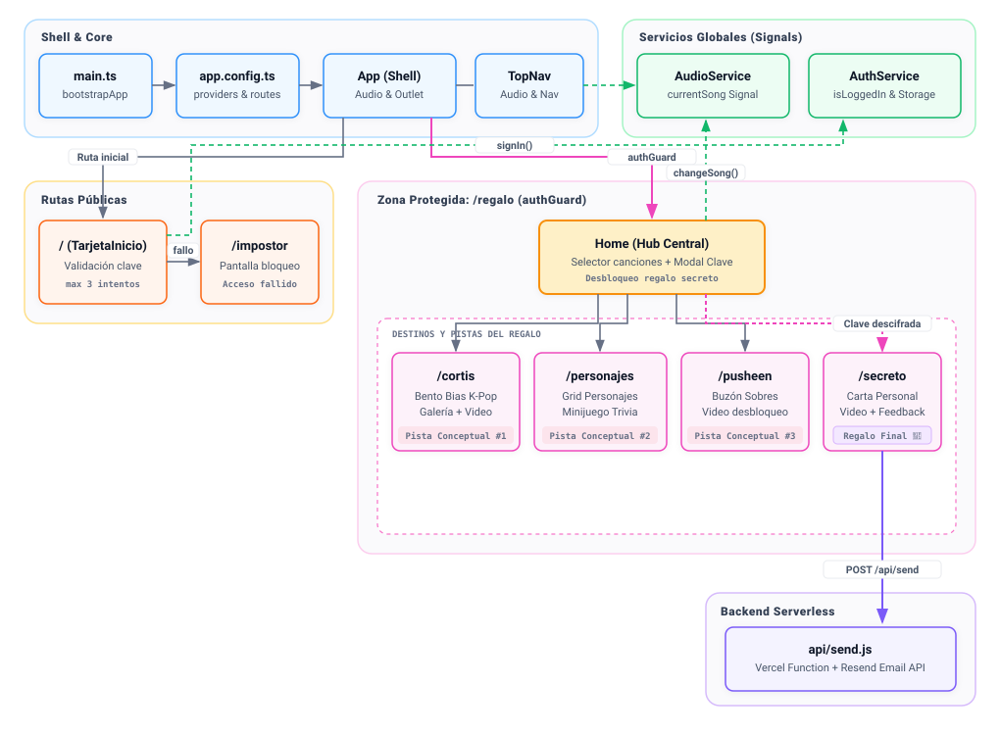

# 🎂 Sorpresa para Tiara 🎁

🌐 **[🚀 Visitar la página web en vivo](https://tiara-cumple-2027.vercel.app/)** 🌐

Este repositorio contiene el código fuente de un regalo digital interactivo creado especialmente para el cumpleaños de mi amiga, Tiara. 

El proyecto es una **Single Page Application (SPA)** concebida como una experiencia inmersiva, visual y personalizada. Combina sus temáticas y gustos favoritos en un formato de "tarjeta web moderna" enriquecida con mecánicas de exploración y *Escape Room*.

> 💡 **Nota sobre el estado del proyecto:** La arquitectura técnica y los sistemas interactivos se encuentran estabilizados. La capa de contenido creativo (textos finales, pistas, cartas y piezas audiovisuales) se encuentra en desarrollo activo y sujeta a iteraciones narrativas previas al lanzamiento.

---

## 🎨 Diseño y Temática

La interfaz está inspirada en una estética **Y2K / Kawaii**, buscando un equilibrio entre diseño editorial moderno y calidez visual:

* **UI / UX Glassmorphism:** Componentes con fondos traslúcidos con efecto de vidrio esmerilado, paleta de colores pastel unificada, tipografías variables (`Fredoka Variable` para encabezados lúdicos y `Quicksand Variable` para lectura) y modales nativos accesibles.
* **Identidad Pusheen:** Animaciones y recursos visuales integrados como lenguaje visual de feedback (reacciones al ingreso de contraseñas, estados de sobres, transiciones de carga y alertas de juego).
* **Ambientación Musical Adaptativa:** Reproductor de música continuo con una selección personalizada de pistas K-Pop, conmutable dinámicamente y con sincronización entre componentes.

---

## 🏗 Arquitectura del Sistema

La aplicación está construida sobre **Angular 22** bajo un modelo estricto de componentes autónomos (*Standalone Components*), complementada con una función *serverless* para eventos transaccionales.



### Shell Principal y Continuidad de Audio
El componente raíz `App` actúa como shell estructural: aloja de forma permanente el reproductor de audio global y el punto de montaje de rutas (`<router-outlet>`). Al mantener el reproductor en la raíz, la música continúa sonando sin interrupciones durante las transiciones entre páginas. La barra superior `TopNav` actúa como interfaz de control global, sincronizándose bidireccionalmente con el reproductor y adaptando las acciones de retorno (`Volver` vs `Salir`) según la ruta activa.

### Enrutamiento y Seguridad (`authGuard`)
El enrutador divide la aplicación en dos dominios:
* **Área pública:** Rutas de acceso (`/` con `TarjetaInicio`) y pantalla de bloqueo preventivo (`/impostor`).
* **Zona protegida (`/regalo`):** Agrupa como rutas hijas el panel central (`Home`) y las distintas subsecciones temáticas. El acceso está protegido por `authGuard`, un guardia funcional (`CanActivateFn`) que verifica la sesión activa en el servicio de autenticación antes de permitir la navegación a cualquier vista protegida.

### Gestión de Estado con Angular Signals
La reactividad global se gestiona mediante señales (`signal`) centralizadas en servicios inyectables:
* **`AudioService`:** Mantiene el estado reactivo de la canción activa y provee la API para alternar fuentes de audio o suspender la música de fondo.
* **`AuthService`:** Controla el estado de autenticación y su persistencia en el almacenamiento local (`localStorage`).

### Flujo hacia el Backend Serverless
La interacción con servicios externos se realiza de manera asíncrona desde la sección final. El formulario de dedicatoria despacha una petición `POST` hacia `/api/send`, ejecutada por una función *serverless* en Node.js que procesa la respuesta y utiliza la API de **Resend** para notificarla directamente por correo electrónico, manteniendo las claves de servidor totalmente aisladas del cliente.

---

## 🚶 Flujo de Navegación y Mecánica de Desbloqueo

La experiencia está diseñada como una progresión no lineal que premia la curiosidad y la exploración:

```
[ Acceso / Login ] ──(Clave válida)──> [ Hub Central (Home) ]
        │                                      │
        └──(Límite de fallos)──> [ Impostor ]  ├──> [ Destino Editorial ] ──> Pista Conceptual #1
                                               ├──> [ Destino Desafío ]   ──> Pista Conceptual #2
                                               ├──> [ Destino Mensajes ]  ──> Pista Conceptual #3
                                               │
                                               └──(Combinación final)─────> [ Destino Secreto ] ──> [ Feedback ]
```

1. **Acceso Inicial (`TarjetaInicio`):** Verificación de identidad. Si se superan los intentos máximos permitidos, el sistema activa una redirección preventiva a una pantalla de bloqueo (`Impostor`). Con la clave correcta, se inicia la sesión y comienza la ambientación musical.
2. **Hub Central (`Home`):** Panel interactivo donde la usuaria puede cambiar la banda sonora en tiempo real y explorar los destinos abiertos. El destino final ("Regalo Sorpresa") permanece protegido con un candado virtual.
3. **Exploración y Recolección de Pistas:**
   - **Destino Editorial:** Espacio temático con formato de revista visual donde, al interactuar con las galerías, se revela la primera pista conceptual.
   - **Destino Desafío:** Galería visual que esconde un disparador hacia un minijuego de preguntas. Superar la prueba de conocimiento otorga la segunda pista conceptual.
   - **Destino Mensajes:** Buzón con sobres interactivos. Abrir todos los mensajes desbloquea la tercera pista conceptual.
4. **Desbloqueo del Destino Secreto:** La usuaria introduce la combinación de las pistas en el modal interactivo de `Home`. El sistema normaliza el texto (eliminando espacios y tolerando variaciones habituales al escribir) y, si coincide con la clave de desbloqueo, habilita el acceso a la sección final.
5. **Experiencia Final y Feedback:** En la zona secreta se accede a la carta principal, material audiovisual especial y un formulario interactivo para enviar su reacción por correo electrónico.

---

## 📁 Estructura del Proyecto

Organización modular del código fuente:

```
tiara-cumple2027/
├── api/
│   └── send.js                           # Endpoint serverless (Vercel + Resend API)
├── docs/
│   ├── architecture.mmd                  # Definición del diagrama en sintaxis Mermaid
│   └── architecture.svg                  # Diagrama de arquitectura optimizado
├── public/
│   └── assets/                           # Activos multimedia estáticos
│       ├── audio/                        # Pistas musicales y efectos sonoros de UI
│       ├── images/                       # Fotografías, portadas, íconos y animaciones
│       └── video/                        # Archivos de video locales
├── src/
│   ├── app/
│   │   ├── components/                   # Componentes de interfaz (Standalone)
│   │   │   ├── cortis/                   # Vista editorial, bento grid y visor de fotos
│   │   │   ├── home/                     # Hub central, selector musical y modal de clave
│   │   │   ├── impostor/                 # Pantalla de bloqueo por intentos agotados
│   │   │   ├── mensajes-pusheen/         # Buzón interactivo con sobres animados
│   │   │   ├── minijuego/                # Trivia interactiva, ruleta, vidas y temporizador
│   │   │   ├── personajes/               # Grilla de personajes y trigger del minijuego
│   │   │   ├── secreto/                  # Vista final: carta, video y formulario
│   │   │   ├── tarjeta-inicio/           # Login inicial, validación y feedback visual
│   │   │   └── top-nav/                  # Barra superior de navegación y control de audio
│   │   ├── guards/
│   │   │   └── auth.ts                   # Guard funcional de protección de rutas (authGuard)
│   │   ├── models/                       # Interfaces, tipos y constantes globales
│   │   ├── services/                     # Servicios singleton (AudioService, AuthService)
│   │   ├── app.config.ts                 # Configuración de proveedores y View Transitions
│   │   ├── app.routes.ts                 # Definición del árbol de rutas y protecciones
│   │   ├── app.ts                        # Componente Shell raíz
│   │   └── app.html                      # Template raíz con el reproductor de audio global
│   ├── main.ts                           # Bootstraping de la aplicación
│   └── styles.css                        # Variables CSS, resets, tipografías y animaciones
├── angular.json                          # Configuración de compilación y presupuestos
└── tsconfig.json                         # Configuración de TypeScript y Path Aliasing
```

---

## ⚙️ Decisiones Arquitectónicas

* **Angular Standalone Components:** Prescinde de módulos tradicionales para simplificar la estructura del proyecto, optimizar el empaquetado (*tree-shaking*) con Vite/esbuild y garantizar que cada componente declare explícitamente sus dependencias.
* **Angular Signals (`signal`, `effect`):** Proporciona reactividad granular y síncrona para estados de interfaz (audio actual, sesión activa, estados de formularios) sin la sobrecarga de suscripciones manuales.
* **Guard Funcional (`authGuard`):** Implementación moderna basada en `CanActivateFn` e inyección de dependencias funcional (`inject()`), simplificando la protección jerárquica de rutas en una sola línea declarativa.
* **Path Aliasing (`tsconfig.json`):** Mapeo de alias semánticos (`@components/*`, `@services/*`, `@models/*`, `@guards/*`, `@environments/*`) para evitar rutas relativas frágiles (`../../`) y simplificar la mantenibilidad.
* **Vercel Serverless Functions (`api/`):** Aísla la lógica que maneja secretos (como la clave privada de email) fuera del paquete del cliente, ejecutándose bajo demanda sin el coste de mantenimiento de un backend tradicional.
* **Resend API:** Plataforma de entrega transaccional para el despacho de correos estructurados con alta confiabilidad y latencia mínima.
* **View Transitions API:** Activada de forma nativa en el router (`withViewTransitions()`) para otorgar transiciones fluidas entre rutas sin añadir librerías pesadas de animación.

---

## 🎯 Características Técnicas Destacadas

* **Coordinación de Medios Cruzada (*Cross-Media Sync*):** El servicio de audio no solo gestiona la lista musical, sino que coordina la pausa y reanudación automática cuando entran en reproducción videos locales o embebidos de plataformas externas.
* **Ruleta de Trivia con Dinámica Trigonométrica:** El minijuego genera su disco visual mediante gradientes cónicos CSS (`conic-gradient`) calculados en tiempo real según las preguntas disponibles, combinándolo con cálculo de rotación angular acumulativa y control de tiempo por intervalos.
* **Modales Nativos Accesibles:** Implementación de ventanas emergentes utilizando el elemento nativo `<dialog>`, garantizando accesibilidad y control de foco estándar.
* **Optimización de Carga Visual:** Priorización intencional de recursos críticos (*above-the-fold*) con atributos de prioridad de carga (`fetchpriority="high"`, `loading="eager"`), mientras que las galerías secundarias y animaciones implementan carga diferida (`loading="lazy"` y `decoding="async"`).
* **Validación Flexible de Contraseñas:** Algoritmo de normalización de cadenas de texto que elimina espacios, normaliza mayúsculas/minúsculas y compara valores centralizados, tolerando variaciones habituales al escribir en dispositivos móviles.

---

## 🚀 Estado del Proyecto y Fases de Desarrollo

### Fase 1: Arquitectura, Rendimiento y Seguridad (Completada)
* [x] Configuración de rutas protegidas y transiciones de vista nativas (`View Transitions API`).
* [x] Arquitectura limpia con Path Aliasing (`@components`, `@services`, `@models`, `@guards`).
* [x] Control de acceso mediante `authGuard` y servicio de autenticación reactivo con Signals.
* [x] Optimización de rendimiento multimedia (`loading="lazy"`, `fetchpriority`, `decoding="async"`, `preload="metadata"`).
* [x] Metadatos Open Graph, Twitter Cards y set completo de Favicons (`apple-touch-icon`, `webmanifest`).

### Fase 2: Componentes e Interacción Global (Completada)
* [x] Selector musical con scroll horizontal y colores dinámicos inyectados desde el modelo de datos.
* [x] Motor de audio global continuo conectado a Signals y sincronizado con la barra de navegación (`TopNav`).
* [x] Menú de navegación gamificado con estados de bloqueo reactivos.
* [x] Modal de acceso al escape room con validación normalizada y animaciones de feedback visual.

### Fase 3: Destinos y Experiencia Interactiva (Completada)
* [x] **Zona Editorial:** Maquetación *Bento Grid*, visor de fotos a pantalla completa, carrusel con *Scroll Snapping* y pista conceptual camuflada en la galería.
* [x] **Zona Coleccionable & Minijuego:** Grilla de tarjetas dinámicas con acceso oculto a la trivia interactiva (ruleta trigonométrica en CSS, temporizador, vidas y comodín 50/50).
* [x] **Buzón Interactivo:** Cuadrícula de sobres interactivos con contador de progreso y revelación progresiva de mensajes.
* [x] **Destino Secreto:** Vista final desbloqueable con carta conmemorativa, reproductor de video especial y pie de página de despedida.
* [x] **Buzón de Respuesta Directa:** Formulario de valoración interactivo conectado al endpoint serverless de Resend.

---

## 🎨 Capa Creativa y Pendientes de Contenido (Pre-Lanzamiento)

A diferencia del núcleo técnico, el contenido narrativo continúa en refinamiento:

* [ ] **Narrativa y Textos:** Redacción de la versión final de la carta conmemorativa en la sección de cierre.
* [ ] **Recursos Audiovisuales:** Renderizado e incorporación de los videos definitivos (pista vertical y video musical conmemorativo).
* [ ] **Ajuste de Pistas y Preguntas:** Revisión del banco de preguntas del minijuego para asegurar el balance de dificultad.

---

## 🛠️ Tecnologías Utilizadas

* **Frontend:** Angular 22 (Standalone Components, Signals, Router, Control Flow nativo), TypeScript, HTML5 semántico.
* **Estilos:** CSS3 nativo (Variables CSS, Bento Layout, Flexbox, CSS Grid, Scroll Snapping, Glassmorphism, `@keyframes`), fuentes variables (`Fredoka`, `Quicksand`).
* **Backend Serverless:** Vercel Serverless Functions (Node.js) + **Resend SDK**.
* **Infraestructura & Despliegue:** Vercel (CI/CD continuo).
